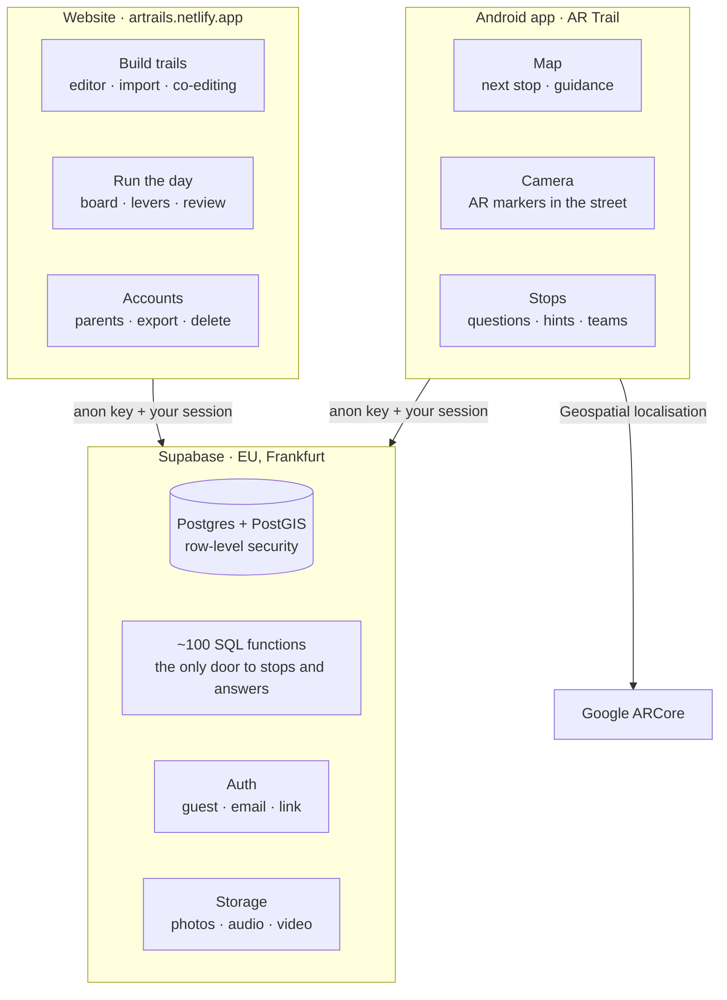
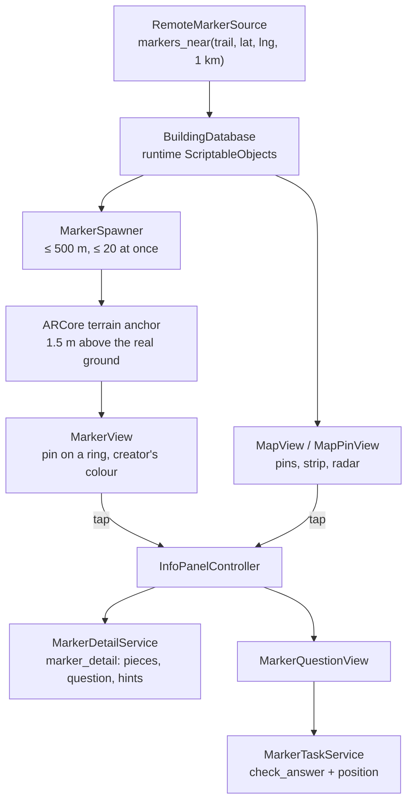

<p align="center"></p>

# AR Trail: the Android app

The Unity project for **AR Trail**, city trails in augmented reality. The website,
the database and the legal file are in
[`noit-platform`](https://github.com/ZalexZal/noit-platform).

**Package:** `com.alex.artrail` · **Version:** 0.2.0 (build 3) ·
**Unity** 6000.4.10f1 · **ARCore Geospatial** · **Website:**
[artrails.netlify.app](https://artrails.netlify.app)

## Contents

- [The idea](#the-idea)
- [The point](#the-point)
- [How it fits together](#how-it-fits-together)
- [What it does](#what-it-does)
- [How the app works inside](#how-the-app-works-inside)
- [Building](#building)
- [Repository layout](#repository-layout)
- [Version history](#version-history)
- [Status](#status)
- [Law, privacy and safety](#law-privacy-and-safety)
- [Credits](#credits)

## The idea

AR Trail turns a walk through a town into a trail of stops that stand in the
street in augmented reality.

Somebody who knows a place (a teacher, a guide, an organiser) builds a trail on
the website. They drop stops on a map and fill each one with text, photos,
audio, video and a question. People walk the trail with the Android app. The map
leads them to each stop. When they raise the phone, the stop stands on its real
spot through the camera, pinned there by Google's ARCore Geospatial service.
Tapping it opens what the creator left there.

The same engine runs four kinds of trail:

| | Walked in order | In any order |
|---|---|---|
| **Keeps a score** (teams, points, leaderboard, priced hints) | Competition (`ctf`) | Freefall (`freefall`) |
| **No score** (questions still asked and answered) | Guided (`guide`) | Educational (`educational`) |

AR Trail was built in Yambol, Bulgaria, by Alexander Zamov, for NOIT, Bulgaria's
national olympiad in information technology. Everything is in Bulgarian and
English.

## The point

City games in Yambol already run as stations: a QR code at each place and
answers sent through a web form. They work, but the phone only ever shows a
form. Nothing stands
at the place itself. AR Trail keeps what those games do well (teams, questions,
a board everyone watches) and adds the part they can't do: the content waits at
the spot where it belongs, and you have to go there to get it.

Four goals shaped every decision:

1. **Anyone can make a trail without writing code.** The website builds it: a
   map, a form per stop, both languages, a spreadsheet import for long trails,
   and co-editing for a class or a team of organisers.
2. **You have to be there.** A stop's contents open only when you stand at it:
   by tapping the AR marker, or from inside the stop's radius when AR can't
   calibrate. On scored trails the server also checks where each answer came
   from, and it refuses answers sent from a fake-location app, from across town,
   or after an impossibly fast jump.
3. **Games have to be fair.** The phone never receives an answer. It is told
   what to ask, never what is right. Every rule is enforced by the database: the
   order, the hints, the cooldown after a wrong answer, and the end of a game. A
   modified app gains nothing.
4. **It has to be safe and lawful to put in front of school children.** It has
   reporting, blocking, a review queue before anything becomes public, removal
   notices, parental consent at 13, a parent account, and data export and
   deletion for everyone. GDPR, the Bulgarian Personal Data Protection Act, the
   EU Digital Services Act, Google Play's policies and ARCore's terms are handled
   in code and written down in [`docs/legal`](https://github.com/ZalexZal/noit-platform/tree/main/docs/legal).

## How it fits together

Two clients, one backend. The website and the app never talk to each other.
Both are clients of the same Supabase project, and the database holds the only
truth.



The two repositories:

| Repository | What is in it |
|---|---|
| [`noit-platform`](https://github.com/ZalexZal/noit-platform) | The website (`web/`), every database migration (`supabase/migrations/`), the end-to-end seam test (`tests/`), the legal file (`docs/legal/`), the Play Store kit (`docs/play-store/`) and the design handbooks |
| [`AR-Trails`](https://github.com/ZalexZal/AR-Trails) | The Unity project for the Android app: scripts, the generated UI, the build and preview tools, the icon |

## What it does

Everything below is built. The [status](#status) section says what has been
proven on a real phone and what still waits for a field test.

### For a walker (the app)

**First run**
- Welcome → terms with the one question the app asks: your age (14 or older /
  13 / 12 or younger) → a practice trail.
- The practice trail puts three stops around wherever you stand, all open from
  there. One of them asks a question. Answers are judged on the phone and never
  sent, so practice never lands on a leaderboard. It ends on "You're ready" and
  the two ways into a real trail.
- Location is asked for once the app is usable. The camera is asked for the
  first time you open the Camera tab, never earlier.

**Getting onto a trail**
- A six-letter trail code, typed into six boxes (letters that look alike, such
  as 0/O and 1/I/L, are never used).
- A link or QR code from the website (`artrail://join/<trail>`), which works only
  for trails that are publicly listed.
- **Near you**: public trails whose first stop is close by, joined with one tap.
- Games (scored trails) ask you to make or join a team before the first stop,
  and need an account rather than a guest session.

**Map tab**
- Street map (Stadia Maps Outdoors at double resolution, with shops, churches and
  banks named, because "past the bank, then left" is a direction). Tiles are
  cached, so a street walked once works without signal.
- Your position with its accuracy circle, and each stop as a pin in the colour
  the creator chose.
- The **next-stop strip**: the last stop you found, where you are, and the next
  stop with its distance ("Stop 3 of 9" on ordered trails; nearest unfound on
  unordered ones).
- **Guide me there**: a banner and an arrow that point at a chosen stop from any
  tab.
- **Nearby alerts**: a card slides in when you come within 60 m of a stop you
  haven't opened (it re-arms at 110 m).
- The trail chip opens your trail list, and its flag reports the whole trail.

**Camera tab**
- Every stop within 500 m stands in the street as a pin on a ring, 1.5 m above
  the real ground (up to 20 at once, released past 650 m).
- Buildings hide the stops behind them (Google's Streetscape Geometry, plus depth
  for close objects). If that data is missing nothing is hidden, because a
  missing mesh must never make a stop disappear.
- A **radar** disc in the corner: north-up, every stop as a dot, an arrow for
  the way you face.
- A calibration chip in plain words (well calibrated / partly / not / can't
  calibrate here).
- **Tapping the AR marker is what counts as finding a stop.**

**A stop**
- Its name, distance and description are visible from anywhere. Its contents
  open only when you're standing at it. "Come closer to open this stop" explains
  why, instead of leaving a blank panel.
- Pieces: text, photos, audio, video. YouTube and Vimeo links open in the
  browser.
- The question, in one of three kinds:
  - **Exact**: typed, and compared with the accepted spellings.
  - **Choice**: one or more options may be correct. You choose, then press
    Check.
  - **Free**: typed, and marked later by the creator.
- What it's worth, the wrong-answer rule in plain words ("Wrong answer: you
  wait", "-5 points", "no second try"), and a countdown during a cooldown.
- **Hints** as a ladder: each has a price, and each opens only after the ones
  above it.
- An afterword the creator wrote, shown only after a correct answer.

**Teams and progress**
- Create a team (you can be a team of one), or join one with its team code. The
  creator sets the team size (1–12).
- The team card: the code at display size for reading out across a room, the
  standings (refreshed every 15 s while open), who is on the team, and anything a
  moderator did to your score, with the reason.
- The progress screen: points, rank, how many stops found, and a **station map**
  of the trail. It shows one line with the stops in order, "you are here", and
  the stops not open yet on ordered trails.

**You tab**
- Profile, stats and **11 badges**: First trail, Guided walker, Flag runner, Free
  roamer, Scholar, Flawless, Trailblazer (with levels), Team player, Captain,
  Summit and Sharp eye. Badges belong to your account and survive a team or trail
  being deleted.
- Account: a guest becomes an account without losing the walk. Also sign-in,
  email confirmation (it continues by itself when you come back from the email),
  changing email and password, blocked people, and deleting the account.
- Settings: light/dark theme, Bulgarian/English, nearby alerts, replay the
  practice trail, About, Data and sources.

**Safety**
- **Report** any stop, trail or team name, with six reasons and one tap.
- **Block** whoever made it (two taps). Their trails leave your library, you
  leave each other's trails, and their team names read "Hidden team". You can
  undo it any time.
- At 13, a **parent has to agree** before trails open: by email, or with a code
  from the parent's account. Until then only the practice trail works. Answering
  "12 or younger" locks sign-up on that phone.

**Creators, on the phone**
- **Capture mode**: on a stop of your own trail, Move opens a bar in the camera.
  You can nudge the marker a metre at a time relative to where you face, or put
  it where you stand, then save. This fixes the metres of error a map click
  always carries.

### For a creator (the website)

- **Create a trail**: name, mode, team size, and whether an ordered trail reveals
  stops one at a time (the ones ahead are then not sent to phones at all).
- **The editor**:
  - A map where you click to place a stop and drag to move it (two fingers on a
    phone).
  - Five tabs per stop:
    - **Basics**: title and text in Bulgarian and English.
    - **Place**: coordinates and an arrival radius, with a warning when radii
      overlap.
    - **Answer**: kind, options, accepted spellings, points, the wrong-answer
      rule and the afterword. The rule is one of **retry**, **lock** (a cooldown,
      15 s by default), **deduct** (points off what the stop is worth) or
      **skip** (one try, then the stop is over).
    - **Hints**: a priced ladder.
    - **Media**: uploads up to 50 MB each and 200 MB per trail. Links also work.
  - A hue slider for each stop's colour, drawn at the exact lightness the phone
    will use.
  - Drag to reorder stops.
- **A trail from a spreadsheet**: one row per stop (CSV or pasted straight from
  Excel), checked row by row in your language before anything is imported, with a
  template that has an example row filled in.
- **Building together**: an invite link makes someone an editor. Editors see
  each other live, and a save over someone's newer version is refused instead of
  silently lost.
- **Who can see it** is a three-rung ladder: *only me* → *anyone with the code* →
  *ask to be listed*. Public listing is a request that a reviewer approves or
  refuses with a reason.
- The join code (large, with a copy button), a QR code, and deleting a trail.
- **Review typed answers** on free-text questions (correct or not). The score is
  marked provisional until then.

### For an organiser on the day (the website board)

- A live leaderboard for every trail. For the owner it adds each team's members
  and code, and warnings about suspicious answer positions.
- **Three levers**, sized for a thumb on a phone:
  - **skip** a stop for a team (it counts as done, worth nothing);
  - **adjust** points, with a reason that the team sees;
  - **disqualify** a team (removed from the board, kept on record).

  Nothing deletes, and everything can be read back.
- **End game**: scores freeze at the whistle.

### For a reviewer (the operator)

- `/review`: the listing queue and the reports inbox, for stops, trails and team
  names. Each report carries a snapshot taken when it was filed, plus a map link,
  so the evidence outlives the thing reported.
- **Remove** with a note, or **Dismiss**. A removal leaves the creator a notice on
  My trails: what was removed, when, the reasons, the note, the rule, that a
  person decided, and how to contest it (the EU Digital Services Act's "statement
  of reasons").
- Block a player from the queue. Rate limits stop scripts: 200 stops and 20
  trails per person per day.

### For a parent

- `/parent`: sign in by an emailed link, with no password. Only a session opened
  from that email can answer for a child.
- One card per child: their trails, teams, finished trails, badges and last
  activity. From it you can **agree** or **refuse**, **download the child's data**,
  or **withdraw consent**, which deletes the child's account.
- **Add a child**: the parent makes a one-time code (valid 7 days), and the child
  types it into the app or the website at sign-up. The same account can hold
  several children.

### For everyone with an account

- Account page: name, email, password, badges, blocked people, **download my
  data** (JSON), and **delete my account**. A creator can choose whether their
  trails go with them or stay, detached and unlisted.
- Public trails page: sorted by distance on request (worked out in the browser,
  so your position never leaves the page), a map link to each trail's start, a
  QR code, and Open in the app.
- How to play, Terms of use and Privacy policy, in both languages.

## How the app works inside

### From a row in the database to a marker in the street



1. **Loading.** `RemoteMarkerSource` asks `markers_near` for the open trail
   around the phone. It never reads the `markers` table. It waits for both a
   GPS fix and a signed-in session, then refetches after 300 m of walking, on a
   trail change, and on return from the background. The last answer is cached
   on disk and shown first, so the app is usable in the first second.
2. **Holding.** Each stop becomes a `BuildingData` object created in memory with
   `ScriptableObject.CreateInstance`, never saved as an asset. This pattern,
   inherited from the AR Architecture Guide, is why the UI didn't have to change
   when the data moved from a spreadsheet to a multi-user database.
3. **Placing.** `MarkerSpawner` resolves each stop within 500 m as a **Geospatial
   terrain anchor**: `ResolveAnchorOnTerrainAsync(lat, lng, 1.5 m)`. ARCore finds
   the real ground height, so no stop carries an altitude. It keeps at most 20
   anchors and releases them past 650 m, a gap that stops flicker at the
   boundary. Failures indoors or before localisation are expected, and the next
   tick retries.
4. **Hiding.** `OcclusionService` hides a marker behind real buildings using
   Streetscape Geometry meshes, stopping 5 m short so a stop's own facade doesn't
   hide it. Depth covers people and cars nearby. **It fails open:** no mesh means
   nothing is hidden.
5. **Opening.** Tapping the AR marker (`CubeTapManager` → `TappableObject`)
   opens the stop sheet. The map pin opens it too, but only shows the contents
   when the rule below allows it.

### When a stop opens, and when it counts

- **Counts as found (`MayCredit`):** always from the camera. From the map only
  when Earth tracking can't calibrate *and* you are inside the stop's radius
  (widened by the GPS accuracy, never narrowed). This way a trail can still be
  finished where AR is unavailable, without letting anyone collect stops from a
  bench.
- **Contents may be shown (`MayReveal`):** the same rule, plus a stop already
  found stays readable. **Nothing is downloaded unless it may be shown.** Hiding
  a question the phone already holds would be a curtain, not a rule.
- **Answers** go through `MarkerTaskService` to `check_answer` with the position,
  its accuracy and Android's mock-location flag (`UserLocationService.IsMocked`,
  read from fresh `LocationManager` fixes). The server decides. The app draws
  what it is told: correct, incorrect, wait (with a countdown), out of order,
  refused for position, or sent for review.

### Accounts and the way in

- **`SupabaseAuth`** signs every new install in **anonymously**, so a first walk
  needs no form, and keeps the session with a stored refresh token.
- **Signing up converts that same user in place** (`PUT /auth/v1/user`), never a
  new sign-up, so the walk done as a guest stays. Signing in to another account
  does not merge anything, and the card says so first.
- **`AccountScope`** stamps the account onto every stored key (progress, cached
  answers, chosen trail, terms record). On a phone shared by a class, nothing
  leaks to the next person. `AccountScopeCheck` fails the build if an unscoped
  key appears.
- **`DoorFlow`** runs the doors one at a time: Welcome → Terms with the age
  question (`AgeChoiceView`) → the practice trail (`DemoTrail`) → My trails /
  Enter a code (`CodeDoor`) → the team gate for games (`TeamDoorView`) → the
  parent door for 13-year-olds (`ConsentDoorView`, `ConsentService`).
- **`TermsService`** records acceptance on the phone at once and on the server
  when there is signal. The version in `SupabaseConfig` must match the website's
  `lib/terms.ts`.

### Working without signal

| Cached | How |
|---|---|
| Stops near you | Last `markers_near` answer on disk, shown first on launch |
| Map tiles | On disk after first sight, keyed by the full tile URL |
| A stop's contents | Saved as they arrive, used only when the network fails (a live edit wins when online) |
| Photos | Disk first, always: a new upload is a new URL, so a kept copy is never stale |
| Video, answers | Need signal, and say so |

### The interface is generated

Nothing under the Canvas is edited by hand. **`AppUIBuilder`** (menu *Tools →
Build App UI*) builds the whole hierarchy from code, using `UIFactory`,
`UIIcons` (icons drawn from signed distance fields) and `UISprites`. Every
graphic carries a `ThemedElement` role, so light and dark switch without
hardcoded colours, and every string comes from `AppStrings` in Bulgarian and
English. The build runs the builder first, so the player always matches the
code.

Seeing it without a phone:
- **`UIPreview.CaptureAll`** renders every screen, in both themes at 1080×1920,
  into `PreviewShots/`. It refuses to run if the build didn't happen or the
  canvas is the wrong size, and it reports controls wired to nothing.
- **`MarkerPreview`** renders the 3D marker from standing height at three
  distances.
- **`CacheCheck`** drives the offline caches through a simulated network
  failure.

### Scripts

| Folder | What lives there |
|---|---|
| `Scripts/` | Inherited core: `BuildingData` (a stop in memory), `GeoMath`, `CubeTapManager` / `TappableObject` (tapping AR objects, legacy Input on purpose), `InfoPanelController` (the stop sheet), `TabNavigationController` |
| `Scripts/AR/` | `MarkerSpawner`, `MarkerView`, `OcclusionService` |
| `Scripts/Services/` | Backend: `SupabaseConfig`, `SupabaseAuth`, `Postgrest`, `RemoteMarkerSource`, `MarkerDetailService`, `MarkerTaskService`, `TrailService`, `TeamService`, `ProfileService`, `TermsService`, `ConsentService`. Device: `UserLocationService`, `AndroidPermissions`, `AppLifecycleWatcher`, `FrameRate`. Behaviour: `DemoTrail`, `DiscoveryTracker`, `GuidanceService`, `ProximityAlerts`, `HiddenMarkers`, `AccountScope`. Look: `AppStrings`, `ThemeManager`, `MarkerPalette`, `MapInk` |
| `Scripts/UI/` | Every screen and control: map (`MapView`, `MapTileLayer`, `MapPinView`, `NextStopStrip`), camera (`CameraTabController`, `CameraRadar`, `CaptureMode`, `VpsIndicatorController`), doors (`DoorFlow`, `CodeDoor`, `TrailsDoor`, `TeamDoorView`, `ConsentDoorView`, `AgeChoiceView`), stop (`MarkerQuestionView`, `HintSheetView`, `MediaPlayerView`, `ReportSheetView`), progress (`TrailGraphView`, `DiscoveryProgressCard`), You (`ProfileView`, `Badges`, `AccountSectionView`, `AccountSecurityView`, `BlockedListView`, `DeleteAccountView`) |
| `Scripts/Editor/` | `AppUIBuilder`, `UIFactory`, `UIIcons`, `UISprites`, `AppFonts`, `AppIcons`, `BuildApk`, `UIPreview`, `MarkerPreview`, `MarkerShapes`, `CacheCheck`, `AccountScopeCheck`, `AndroidPermissionsManifest` |

## Building

**Requirements:** Unity **6000.4.10f1** with Android support, URP 17.4, AR
Foundation with the ARCore XR plugin 6.4.3, and ARCore Extensions (`arf6`). The
Input System package stays at `activeInputHandler: Both`, because tapping AR
objects uses legacy Input on purpose.

**Android settings:**
- Package `com.alex.artrail`, version 0.2.0 (3).
- Minimum Android 10 (API 29). Targets the newest installed SDK (API 36).
- ARM64 only, IL2CPP.
- ARCore is **optional**, so phones without it still get the map, the library
  and the website trails.

```sh
# the password is read from the environment, never from a file in this repo
export ARTRAIL_KEYSTORE_PASS="…"
Unity -batchmode -quit -projectPath . -buildTarget Android -executeMethod BuildApk.Build        # Build/ARTrail.apk
Unity -batchmode -quit -projectPath . -buildTarget Android -executeMethod BuildApk.BuildBundle  # Build/ARTrail.aab for Play
Unity -batchmode -quit -projectPath . -buildTarget Android -executeMethod UIPreview.CaptureAll  # PreviewShots/*.png
```

The same actions are under *Tools → Build* in the editor. `BuildApk`:
1. Regenerates the UI and saves the scene.
2. Applies the launcher icon (`AppIcons`, from `Tools/make_icons.py`).
3. Puts back the XR preloaded assets that command-line builds silently drop.
   Without them the camera feed is black.
4. Signs with the release keystore.

It **refuses to build** when a keystore is configured but no password is given,
rather than handing back a debug-signed APK that looks like a release. The IL2CPP
step needs several GB of RAM, so don't run it alongside other heavy builds.

**Keys in the app, and why that's fine:**
- The Supabase URL and anon key (`SupabaseConfig`) are public by design. Every
  table they can reach is guarded by row-level security.
- The Stadia Maps key can't be locked to an app, so the defence against misuse
  is rotating it.
- The Google ARCore API key is restricted to this package and signing
  certificate.
- The keystore itself and its password live outside the repository
  (`C:/Users/zalex/keys`). Back them up: an app can only be updated with the key
  it was first signed with.

## Repository layout

```
Assets/
  Scripts/          all C# (see the table above)
  Scenes/Main.unity the one scene, regenerated by AppUIBuilder on every build
  Art/Icon/         launcher icon layers (adaptive, round, legacy)
  Art/Tutorial/     illustrations
  Fonts/            Inter, with Cyrillic
  Prefabs/, UI/, Resources/, Generated/   built UI pieces, icons, textures
  XR/               ARCore and XR Management settings
Packages/           manifest (AR Foundation, ARCore Extensions, URP, Input System)
ProjectSettings/    Android package, version, signing path (no passwords)
Tools/make_icons.py draws the launcher icon from the website's pin
PROJECT.md, PROJECT-CONTEXT.md   the handbook of the predecessor app, AR Architecture Guide,
                                 kept for the history of the inherited AR pipeline
```

`Build/`, `PreviewShots/`, `Library/` and all keystores are gitignored.

## Version history

AR Trail was built in seven versions between 26 August and 27 September 2026.
Each one ended with something working end to end. The numbers below are the
project's own names for those stages. The **Android build** column is what the
app itself reported: `versionName` 0.1.0 until 23 September and 0.2.0 since.
Google Play will see 0.2.0 as the first release.

| Version | Dates (2026) | Name | Android build | Database |
|---|---|---|---|---|
| 1 | 26–28 Aug | The gate: one marker in the street | 0.1.0 (1), `com.alex.artrail.dev` | 0001 |
| 2 | 28 Aug – 2 Sep | Glass Trail: a map-first app with identity | 0.1.0 (1) | 0002–0004 |
| 3 | 3–9 Sep | The platform: website, teams and the game engine | 0.1.0 (1) | 0005–0036 |
| 4 | 14–15 Sep | Accounts, the law, and a real release identity | 0.1.0 (2), `com.alex.artrail`, own signing key | 0037–0041 |
| 5 | 18–23 Sep | Field tests, the public library and the demo | 0.1.0 (2) | 0042–0043 |
| 6 | 25 Sep | Stage 2: safe, fair, built together, ready for Play | **0.2.0 (3)**, first `.aab` | 0044–0048 |
| 7 | 27 Sep | The parent account, and the law kept | 0.2.0 (3), rebuilt | 0049–0051 |

### Version 1: The gate (26–28 August)

One question had to be answered before anything else was worth building: does a
point clicked on a web map in a browser become a marker standing on the right
spot in a real street?

- **App:** forked from the author's earlier *AR Architecture Guide* (an AR guide
  to Yambol's buildings). That kept its proven AR pipeline, UI toolkit and the
  runtime `ScriptableObject` pattern, which let the whole UI move to a
  multi-user backend with one new file (`RemoteMarkerSource`). The fragile Cesium
  dependency was dropped. The package was a throwaway `com.alex.artrail.dev`.
- **Database (0001):** `worlds` and `markers`, with PostGIS `geography` points
  and a spatial index. It also added **`markers_near(world, lat, lng, radius)`**,
  the rule that has held ever since: *the app never reads the markers table*.
  Every read goes through a function, so hidden stops can stay hidden and answers
  never leave the server.
- **Web:** a throwaway "marker dropper" page (MapLibre + supabase-js) that places
  one marker by clicking a map.
- **Design:** one colour token file shared by the app and the web.
- **Result, 28 August:** a marker placed in a browser was seen standing on its
  spot in Yambol, in the colour chosen in the browser, on an ARCore terrain
  anchor with no altitude data. The reported accuracy was 0.5 m. Occlusion was
  confirmed to fail open indoors, as designed.

Commits: website `c7223e0`–`fe45a41` · app `15b82df`–`e74390d`

### Version 2: Glass Trail, a map-first app with identity (28 August – 2 September)

- **App: rebuilt around a map.** It used to open on a camera screen. Now it opens
  on a drawn street map with you at the centre and stops where they really are.
  The camera is a tab you choose. The whole UI is generated by one editor script
  (`AppUIBuilder`), so there is no hand-wiring to lose.
- **App: new pieces.**
  - "Guide me there", a bearing arrow and state cards.
  - Nearby alerts (60 m, re-arming at 110 m) and a first-run walkthrough.
  - The **radar** camera tab, north-up.
  - OpenStreetMap tiles cached to disk.
  - An icon set drawn from signed distance fields.
- **App: measured fixes.** Text contrast raised to 4.5:1, touch targets to 48 dp,
  portrait only, press feedback on every control, and a frame-rate fix (layout
  only when something changed, 60 fps instead of the camera's 30).
- **App: `UIPreview`.** It renders every screen to PNG from the command line. It
  exists because the UI was being built by someone who couldn't see it, and it
  caught real bugs from its first run.
- **App: the way in.** Welcome, Terms, My trails and Enter a code. A stop holds
  text, video, audio and a question.
- **App: identity.** Anonymous sign-in, trail membership, and a terms record kept
  both on the phone and on the server.
- **App: first-launch crash fixed.** ARCore's VPS check ran on a background
  thread with no AR session behind it, and the process died. The session now
  starts when the Camera tab first opens, and ARCore became *optional* so the map
  works on any phone.
- **App: small additions.** Leave a trail. The **next-stop strip** says where you
  are up to instead of what is nearest.
- **Database:**
  - **0002** closed the development policies. It added profiles, trail
    membership with roles (owner/editor/viewer) and security-definer role checks.
    `markers` has no read policy at all.
  - **0003** stopped members listing other members.
  - **0004** added stop order.

Commits: website `74d8569`–`efc1aff` · app `9f64d8f`–`989a321`

### Version 3: The platform, with website, teams and the game engine (3–9 September)

The biggest version: the website was built from nothing, and the database grew
the whole game.

- **Database (0005–0036):**
  - **Teams and scoring.**
    - Teams, where a solo player is a team of one.
    - Answers kept in a table *no player can read*.
    - Progress per team, written only by `check_answer`.
    - A leaderboard, the one aggregate allowed out.
  - **Your data:** export and delete your account data.
  - **Security fixes.** Internal functions such as `award_progress` were
    callable with the public key (a "give me points" endpoint), and 0011 closed
    them all. Five guards were inverted by `NULL` logic and let strangers edit
    other people's trails, which 0012 fixed. 0013 fixed an account deletion that
    tripped over its own foreign keys.
  - **Stops:**
    - An arrival radius, hints with prices and media uploads (50 MB).
    - A cooldown after a wrong answer, and an afterword that arrives only with a
      correct answer.
    - `marker_detail`, which returns a stop's contents and never its answer.
  - **The listing gate:** "public" is a request a reviewer approves.
  - **The four wrong-answer rules:** retry, lock, deduct, skip.
  - **Moderation:** reports that keep a snapshot, removal, per-person rate
    limits, and who placed each stop.
  - **Codes:** unguessable trail and team codes from `gen_random_bytes` (31
    letters, no look-alikes).
  - **Organisers:** they can see teams and codes. Creators set team size (1–12).
    Each trail gets a 200 MB media cap, and deleting a file finally works.
  - **Four modes with real rules (0028).** Order and one-at-a-time reveal are
    enforced by the server, not drawn by the app. A game needs a team, and
    joining one brings your walk with you. Hints open in order.
  - **Moderator levers:** skip, adjust and disqualify, each on the record, and
    teams see what was done to them.
  - **A race at the stop.** Ten teams answering at once showed that two phones
    on one team could cancel each other's correct answer. A correct answer from a
    different member within 3 s of a wrong one is now forgiven.
  - **Scored trails need an account**, and a mistyped code answers "no trail
    with that code" instead of a server error.
- **Website (Astro 7 + Tailwind 4 + GSAP, Bulgarian at `/`, English at
  `/en/`):**
  - Home, public trails, sign-up/in, account (history, export, delete).
  - The creator portal: create a trail, a tabbed editor on a MapLibre map, a
    colour slider, drag-to-reorder and **spreadsheet import**.
  - My trails with the visibility ladder.
  - `/review` (listings and reports), the **board** with team cards and the
    moderator panel, and How to play.
  - A component layer and a hosting guide.
- **App:**
  - **It now reads what the website writes.** Twelve contract mismatches were
    fixed: media and questions come from `marker_detail`, and the answer call
    finally matches `check_answer`'s arguments and replies.
  - **Accounts in the app.** A guest is upgraded in place, so the walk survives.
    The app asks for a display name.
  - **Stops:** a real 3D marker (a pin on a ring, generated from arithmetic,
    checked with a `MarkerPreview` renderer), hints and their prices, the stop's
    worth, and choose-then-Check.
  - **Teams:** teams and standings, and a team gate before a game.
  - **Reporting** stops and whole trails.
  - **Offline:** stop contents and pictures are kept for walking without signal.
  - **Map and progress:** Stadia Outdoors tiles at double resolution, and a
    progress screen with a **station map**.
- **Tests:**
  - `verify_phase2.sh` checks row-level security as two different users.
  - `verify_flow.mjs` walks the product as a creator, a player and a stranger.
  - `check.mjs` and `check_signedin.mjs` drive a real browser in both languages,
    both themes and two widths.
  - **`tests/seam.mjs`** makes 46 checks across the seam between website and
    app.

Commits: website `b6c7281`–`e6c2f18` · app `a8d3f97`–`a1d1320`

### Version 4: Accounts, the law, and a real release identity (14–15 September)

- **Database:**
  - **0037** accepts the file types people actually have (HEIC, M4A, MOV, …).
  - **0038** keeps a record of the walk (`stop_visits`) and adds an **End game**
    button. **0039** makes ending a game actually freeze scoring.
  - **0040**: badges count only stops a team really settled.
  - **0041** closes the last development policy, which let anyone with the
    public key list every trail's join code.
- **Website:**
  - The account page with badges.
  - The legal pages name the data controller.
  - Signing up needs an explicit tick against the Terms and Privacy policy,
    recorded with its version.
  - **The site deploys itself** from GitHub through Netlify.
- **App:**
  - The **You** tab: profile, badges, security and delete account.
  - Everything personal (progress, cached answers, chosen trail, terms record) is
    stored **per account**, so a phone passed around a class leaks nothing.
  - **A stop's contents open only when you are at it**, because on a scored trail
    reading a question from a bench across town is the answer given away.
  - The Android back key, and audio on Android.
  - The app got its permanent package `com.alex.artrail`, and is **signed with
    the project's own keystore**. The build refuses to produce a debug-signed APK
    when a release one was asked for.

Commits: website `cc3c5c0`–`6ae1e4d` · app `ed65a44`–`06b2f94`

### Version 5: Field tests, the public library and the demo (18–23 September)

- **Field-test fixes:**
  - Multiple choice sent the option's text while the server read it as a
    position, so answers came back right or wrong at random. It now sends the
    position.
  - The "wait" reply during a cooldown was drawn as a wrong answer and crossed
    out the right option.
  - A trail chosen while markers were loading was dropped.
- **Cleanup:** Google's ARCore sample scenes, which carried an unused Maps key,
  were deleted.
- **Database:**
  - **0042**: `trails_near` and `join_listed` for a public library, and a 15 s
    default cooldown.
  - **0043**: the first stop's position for each trail.
- **Website:**
  - Public trails with distance, a map link and a **QR code** that opens the
    app.
  - The app's blue accent.
  - A phone menu. The editor map fits the trail and scrolls with two fingers.
  - Deleting a trail, a 404 page, and translated error messages.
- **App:**
  - **A practice trail instead of a manual.**
  - **Near you** (the public library) and `artrail://join` links.
  - A quieter, Apple-like look (Inter, one blue, capsule buttons).
  - A full pass on a real phone: back, audio length, YouTube/Vimeo, 8-character
    passwords, sign-out on this phone only, and mode names that match the
    website.

Commits: website `e4f90ac`–`cc8b463` · app `3b4fdca`–`974df73`

### Version 6: Stage 2, safe, fair, built together, ready for Play (25 September)

- **Database:**
  - **0044 Blocking a person**, in both directions, across library, joins and
    boards. Team names can be reported too.
  - **0045 Where the answer came from.** On scored trails every answer carries
    the phone's position and Android's mock-location flag. The server refuses:
    - a faked position;
    - an answer from further than the stop's radius + accuracy + 200 m;
    - a jump faster than 60 m/s since the last accepted answer.

    Refusals are written down for the organiser without coordinates, and the last
    position is kept for one day only.
  - **0046 Building it together**: editor invite links, a list of editors, and
    live updates through Realtime.
  - **0047 A parent says yes**: an age band with the terms, parental consent
    records, and a database trigger that blocks joining, answering and building
    until a parent agrees.
  - **0048 Proof of the inbox**: a parent's answer counts only from a session
    opened by the emailed link.
- **Website:**
  - Blocked people. Report and Block on the board.
  - Co-editing in the editor: invite, presence, live stops, version-checked
    saves.
  - New pages: `/editor-invite`, `/confirmed`, `/consent`, `/reset` (password
    reset, which didn't exist before) and `/accept-terms`.
  - Sign-up asks the age.
  - Terms and privacy rewritten.
  - The Play Store kit: icon, feature graphic, listing texts, email templates.
- **App:**
  - Block, the fake-GPS check and **capture mode**.
  - Email confirmation handled end to end.
  - The parent-consent door.
  - Google's required ARCore notices.
  - **The launcher icon** (there was none; it was Unity's default).
  - Version 0.2.0 (3), and the first **Android App Bundle** for Play.

Commits: website `2894c5e` · app `c968425`

### Version 7: The parent account, and the law kept (27 September)

- **Database:**
  - **0049 A badge is yours.** Badges and finished trails belong to the person
    and survive a team, a membership or a trail being deleted.
  - **0050 A parent's account.**
    - Parents make one-time codes for a child's account and see each child's
      activity.
    - They can download a child's data and withdraw consent.
    - Every removal leaves the creator a statement of reasons.
  - **0051 Thirteen stays thirteen.** An account that answered "13" can never be
    switched back to "14 or older", so a child cannot answer again past a
    parent's refusal.
- **Website:**
  - `/parent`.
  - A parent's code at sign-up. A wrong code lands on the account page, which
    asks again.
  - Removal notices on My trails.
  - Terms version 2026-09-27: why 13 is the minimum, both consent routes, the
    parent's powers and an ARCore section.
  - **`docs/legal`**: records of processing, a risk assessment for children's
    data, processors, a breach plan, moderation rules and dated decisions.
- **App:**
  - The consent door takes a parent's code.
  - "12 or younger" locks sign-up on that phone.
  - The "I'm actually 14" shortcut is gone.
  - ARCore and depth are optional, so the store offers the app on phones without
    them.

Commits: website `444b0e0` · app `8fd24d0`

### Since version 7

- These README files.
- The store listing now says the practice trail has three stops (it said two).

## Status

*As of 29 September 2026. The goal is a Google Play release; the date is not
set.*

**Proven.** Each of these has been checked on a Samsung Galaxy A54 (Android 16),
against the live database, or in a real browser, with the throwaway accounts
deleted afterwards:

- A stop placed in a browser stands on its spot in Yambol (0.5 m reported
  accuracy).
- A fresh install launches and joins a trail by code. The map draws, the camera
  works, and a stop opens at 11 m and stays shut at 472 m.
- A guest is upgraded to an account without losing the walk.
- Multiple-choice and typed answers, cooldowns and a teammate's race are scored
  correctly.
- 46/46 seam checks between website and app.
- On the live site, 31/31 stage-2 checks and 20/20 parent-account checks.
- Every database migration is applied and tested.

**Built, waiting for a phone or an outdoor test:**
- Version 6 and 7 on the phone: block, the fake-GPS refusal, capture mode, the
  parent-consent door and parent code, and email confirmation.
- Two phones racing at one stop outdoors.

**Waiting on the operator:**
- An email service in Supabase, so email confirmation and parent emails reach
  anyone.
- The Google Play developer account, store listing and 14-day closed test with
  12 testers.
- Signing Supabase's data processing agreement.
- A lawyer's read of the terms and privacy policy (the pages say they are an
  unreviewed draft until then).
- 3–5 real public trails.

**The original roadmap**, from the platform handbook:

| Phase | | |
|---|---|---|
| 0 Backend + one marker end to end | ✅ | Version 1 |
| 1 Accounts, trails, membership, row-level security | ✅ | Version 2 |
| 2–3 Creator portal; app on the new backend | ✅ | Version 3 |
| 4 Real-time co-editing with safe saves | ✅ | Version 6 |
| 5 Moderation: terms, report, block, inbox | ✅ | Versions 3, 6, 7 (the admin map and a blocklist of sensitive places are not built) |
| 6 Public library with an approval queue | ✅ | Versions 3, 5 |
| 7 Capture mode | ✅ built | Version 6, outdoor test pending |
| 8 Competition mode with server-side answers and anti-spoofing | ✅ | Versions 3, 6 |
| 9 Creators' own 3D models | ⏸ deferred | |
| 10 Store preparation | 🟡 | Built; the operator's steps remain |
| 11 iPhone | ⏸ | Needs a Mac |

## Law, privacy and safety

- **Who may use it:**
  - 14 and older alone.
  - 13 only with a parent's consent (Bulgarian Personal Data Protection Act art.
    25c, GDPR art. 8), given by an emailed link or through a parent account.
  - Nobody under 13, because Google's ARCore terms forbid the Geospatial API in
    any service directed to children under the US COPPA rule.
  - Answering "13" is final, and answering "12 or younger" locks sign-up on that
    device.
- **What is kept:**
  - Email, an optional display name, the age band (never a birth date), what you
    walked and answered, and badges.
  - On scored trails, the last accepted position for one day.
  - Refusals without coordinates.
  - No advertising, no analytics of our own and no tracking SDKs. Google's
    ARCore processes camera frames and location as its notice describes.
- **Your rights in the product:** download your data, delete your account (it
  takes fewer taps than signing up), block people, and see why something of
  yours was removed and how to contest it.
- **Content:**
  - Nothing is public until a person approves it.
  - Every stop, trail and team name can be reported.
  - Removal takes the files with it and leaves a statement of reasons (EU
    Digital Services Act art. 17).
- **Paperwork:** records of processing (GDPR art. 30), a data protection impact
  assessment, the list of processors, a 72-hour breach plan and the moderation
  rules are in [`docs/legal`](https://github.com/ZalexZal/noit-platform/tree/main/docs/legal).
- **Google Play and ARCore:**
  - ARCore's required notices appear on the terms screen, in Data and sources,
    and before the first camera session.
  - The Data Safety answers and the account-deletion URL
    (`/en/privacy/#delete`) are prepared in `docs/play-store`.

## Credits

Made by **Alexander Zamov** (Yambol, Bulgaria), who is also the data controller
named in the terms. Contact: zalex8623@gmail.com.

Built with [Claude Code](https://claude.com/claude-code) as a pair programmer;
the commits that were written together say so.

Maps © Stadia Maps, © OpenMapTiles, © OpenStreetMap contributors (app);
OpenFreeMap © OpenStreetMap contributors (website). AR by Google ARCore. Backend
by Supabase. Typefaces Inter (app), Unbounded, Onest and JetBrains Mono (website), all
under the SIL Open Font License.

Both repositories are private, and no licence to reuse the code is granted.
